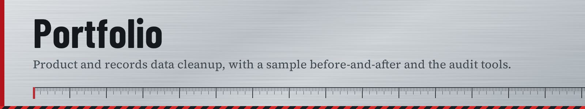

# Portfolio

Source of [vineetbasantani1.github.io/portfolio](https://vineetbasantani1.github.io/portfolio/): catalog, part-number and vendor-record cleanup for tool, hardware, welding and auto-parts businesses.

- [`index.html`](index.html): the site, a single page with no build step
- [`case-studies/nutrition-data-cleanup/`](case-studies/nutrition-data-cleanup/): a before-and-after cleanup sample
- [Shopify Catalog Audit Tools](https://github.com/vineetbasantani1/shopify-catalog-audit-tools): the scripts the audit uses
